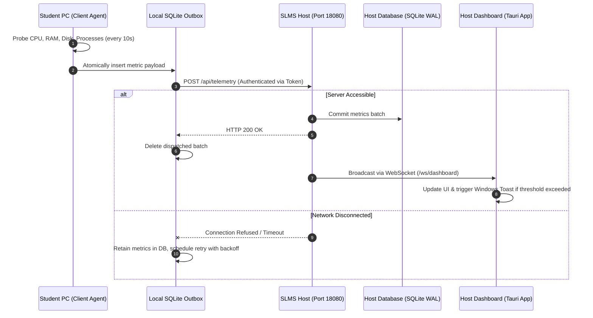

# Smart Lab Management System (SLMS) - System Architecture

## 1. Executive Summary

The **Smart Lab Management System (SLMS)** is an enterprise-grade workstation orchestration, hardware telemetry, and remote administration platform designed specifically for academic, institutional, and research computer laboratories.

SLMS is engineered around three foundational architectural principles:
1. **Separation of Concerns**: Unprivileged student desktops run lightweight, non-blocking monitoring agents, while the lab teacher/administrator runs a centralized service and desktop dashboard.
2. **Session 0 Isolation Compliance**: Background services run strictly under Windows Service Control Manager (`NT SERVICE\SLMSService` and `LocalSystem`), while desktop notifications and user interfaces run in interactive user desktop sessions (Session 1+).
3. **Zero Resource Interference**: SLMS uses a dedicated high-range port (`18080`) and an ultra-lightweight **Tauri v2** native desktop shell (~20–40 MB RAM), ensuring the monitoring software never interferes with students' developer environments (such as FastAPI, React, or Django apps running on default ports like 8000).

---

## 2. High-Level System Architecture Diagram

```
+=========================================================================================================+
|                                         SLMS HOST COMPUTER (Teacher / Admin PC)                         |
+=========================================================================================================+
|                                                                                                         |
|  +---------------------------------------------------------------------------------------------------+  |
|  |  SESSION 1 (Interactive Windows User Session)                                                     |  |
|  |                                                                                                   |  |
|  |  +---------------------------------------------------------------------------------------------+  |  |
|  |  |  SLMS Host Dashboard (Tauri v2 Native Desktop Shell - ~25 MB RAM)                           |  |  |
|  |  |                                                                                             |  |  |
|  |  |  [React 19 Frontend + Vite]        [Rust Tauri Backend Engine]                              |  |  |
|  |  |  - Live Grid & Workstation Telemetry  - Windows System Tray (Close-to-Tray)                 |  |  |
|  |  |  - Threat & Security Panel           - Windows Action Center Toast Notification Provider    |  |  |
|  |  |  - Remote Control & Software Audit   - WebSocket Client (ws://127.0.0.1:18080/ws/dashboard) |  |  |
|  |  +---------------------------------------------------------------------------------------------+  |  |
|  +--------------------------------------------------|------------------------------------------------+  |
|                                                     | Localhost IPC (ws://127.0.0.1:18080)               |
|  +--------------------------------------------------v------------------------------------------------+  |
|  |  SESSION 0 (Non-Interactive Background Windows Service - LocalSystem)                             |  |
|  |                                                                                                   |  |
|  |  +---------------------------------------------------------------------------------------------+  |  |
|  |  |  SLMS Host Service (FastAPI + Uvicorn + SQLAlchemy WAL Database - Dedicated Port 18080)     |  |  |
|  |  |                                                                                             |  |  |
|  |  |  - Telemetry Ingestion Engine & High-Speed Batch Writer                                    |  |  |
|  |  |  - Real-Time Alert & Threshold Evaluator (RAM, CPU, Disk, Security Anomaly)                 |  |  |
|  |  |  - Workstation Heartbeat Monitor (Auto-detects offline workstations after 30s)             |  |  |
|  |  |  - Command Dispatch & Software Inventory Database (SQLite with WAL + 30s busy timeout)     |  |  |
|  |  |  - Enterprise Rotating File Logger (%ProgramData%\SLMS_Host\logs\service.log)              |  |  |
|  |  +---------------------------------------------------------------------------------------------+  |  |
|  +---------------------------------------------------------------------------------------------------+  |
+=====================================================▲===================================================+
                                                      |
                                                      | Local Area Network (TCP Port 18080 - HTTP / WSS)
                                                      |
+=====================================================▼===================================================+
|                                    STUDENT WORKSTATIONS (1 to 100+ Lab PCs)                              |
+=========================================================================================================+
|                                                                                                         |
|  +---------------------------------------------------------------------------------------------------+  |
|  |  SESSION 1+ (Interactive Student Desktop Session)                                                 |  |
|  |                                                                                                   |  |
|  |  +---------------------------------------------------------------------------------------------+  |  |
|  |  |  SLMS Notifier (Session 1 Desktop Companion - SLMS_Notifier.exe)                             |  |  |
|  |  |  - Displays teacher broadcast messages, exam countdowns, and maintenance alerts             |  |  |
|  |  |  - Communicates with local agent service via authenticated named pipe / localhost IPC        |  |  |
|  |  +---------------------------------------------------------------------------------------------+  |  |
|  +---------------------------------------------------------------------------------------------------+  |
|                                                                                                         |
|  +---------------------------------------------------------------------------------------------------+  |
|  |  SESSION 0 (Non-Interactive Windows Service - NT SERVICE\SLMSService)                            |  |
|  |                                                                                                   |  |
|  |  +---------------------------------------------------------------------------------------------+  |  |
|  |  |  SLMS Client Agent (Modular Python 3.13 Runtime - SLMS_Client_Agent.exe)                     |  |  |
|  |  |                                                                                             |  |  |
|  |  |  - Metric Collector: CPU, RAM, Disk, Active Processes, Software Inventory, Network Specs   |  |  |
|  |  |  - Durable SQLite Outbox: Stores telemetry offline during network disconnects                |  |  |
|  |  |  - Outbox Dispatch Worker: Exponential backoff retransmission upon reconnection               |  |  |
|  |  |  - DPAPI Credential Store: Machine-scoped DPAPI encryption (%ProgramData%\SLMS\config)       |  |  |
|  |  |  - Duplex WebSocket Client: Receives lock, restart, message, and process kill commands     |  |  |
|  |  +---------------------------------------------------------------------------------------------+  |  |
|  +---------------------------------------------------------------------------------------------------+  |
+=========================================================================================================+
```

---

## 3. Core Component Breakdown

### 3.1. SLMS Host Service (`backend/`)
- **Runtime**: FastAPI asynchronously served via Uvicorn behind a Windows Service Control Manager (SCM) wrapper (`service_runner.py`).
- **Dedicated Port**: Binds to `0.0.0.0:18080` (overridable via `PORT` environment variable). This guarantees zero port collision with student web development projects running on default developer ports (e.g. `8000`, `3000`, `5000`).
- **Database Engine**: SQLite 3 with Write-Ahead Logging (`PRAGMA journal_mode = WAL`), `synchronous = NORMAL`, and a `busy_timeout = 30000ms`. This configuration supports high-concurrency read/write operations from 100+ workstations simultaneously without lock contention.
- **Fail-Safe SCM Configuration**: Registered with Windows Service Control Manager with automatic recovery actions (`reset= 86400 actions= restart/5000/restart/5000/restart/5000`), ensuring the service restarts within 5 seconds if an unexpected exception occurs.

### 3.2. Host Desktop Dashboard (`frontend/` & `frontend/src-tauri/`)
- **Technology**: Built using **Tauri v2** (Rust backend + React 19 / Vite frontend).
- **Why Tauri over Electron?**
  - **Memory Footprint**: Tauri utilizes the OS-native Microsoft Edge WebView2 control rather than bundling a full Chromium browser and Node.js runtime. This drops idle RAM from **~150–300 MB (Electron)** to **~20–40 MB (Tauri)**.
  - **Binary Size**: Packaged desktop installer is ~15 MB rather than ~120 MB.
- **System Tray Integration**:
  - Clicking the window close button (`X`) triggers `WindowEvent::CloseRequested`. The event is intercepted, preventing app termination and smoothly hiding the window to the Windows System Tray.
  - Left-clicking the tray icon restores and focuses the window.
  - Right-clicking opens a context menu with **Show Dashboard** and **Quit SLMS Host**.
- **Native Windows Toast Notifications**:
  - Integrated with the Windows Action Center via `tauri-plugin-notification`.
  - When the dashboard is minimized to the system tray, real-time alerts received over WebSocket (e.g. Workstation RAM > 90%, sudden disconnection, unauthorized process) trigger a native Windows toast notification banner in the bottom-right corner with sound.

### 3.3. Client Agent (`client_agent/`)
- **Execution Mode**: Runs as a 64-bit Windows Service (`SLMSService`) running under the local system account.
- **Durable SQLite Outbox**:
  - Telemetry snapshots are written to a local SQLite outbox database (`%ProgramData%\SLMS\data\outbox.db`).
  - A dedicated background delivery thread drains the outbox queue.
  - If the lab Wi-Fi or Ethernet switches go down, metrics buffer locally on disk without memory leaks. Once connectivity to the Host is re-established, the agent flushes the buffered telemetry in chronological order.
- **Security & DPAPI Credentials**:
  - The client agent never stores plaintext API secrets.
  - Upon workstation enrollment, credentials (agent ID, machine token, and server URL) are encrypted using the Windows Data Protection API (**DPAPI**) scoped to `CRYPTPROTECT_LOCAL_MACHINE`.
  - Credentials can only be decrypted by processes running with local administrative or `SYSTEM` privileges on that specific physical computer.
- **Notification Companion (`SLMS_Notifier.exe`)**:
  - A lightweight companion application registered in `HKLM\Software\Microsoft\Windows\CurrentVersion\Run`.
  - Launches in the interactive student desktop session upon logon, listening for broadcast announcements and maintenance messages sent from the Host.

---

## 4. Communication Protocols & Data Flow

### 4.1. Automatic Port & Scheme Resolution
When enrolling a student workstation, the client agent and setup wizard employ intelligent URL normalization:
1. If the user enters only an IP or hostname (e.g. `192.168.1.100`), the normalizer:
   - Prepends `http://`
   - Appends the dedicated port `:18080`
   - Normalizes to `http://192.168.1.100:18080`
2. If an administrator specifies a custom port (e.g. `https://slms.university.edu:8443`), the custom scheme and port are strictly preserved.

### 4.2. Telemetry Ingestion Flow


### 4.3. Remote Command & Control Flow
1. **Teacher Action**: Teacher selects 15 computers in the dashboard and clicks **Lock Workstations** or **Send Broadcast Announcement**.
2. **Host Dispatch**: The Host pushes a JSON command payload across the active duplex WebSocket connection (`/ws/client`).
3. **Client Reception**: The client agent receives the command, validates the payload signature, and executes the action (e.g., locking the desktop or alerting `SLMS_Notifier.exe`).
4. **Execution Acknowledgment**: The client sends an execution report back over the WebSocket to update the dashboard status indicator to "Completed".

---

## 5. Security & Isolation Invariants

1. **Session 0 Isolation**: Neither the Host Service nor the Client Agent ever attempt to invoke GUI windows directly from Session 0. All UI is delegated to interactive desktop companions (Tauri Dashboard on Host, `SLMS_Notifier` on Clients).
2. **Credential Non-Exportability**: DPAPI encryption keys are tied to the local motherboard and Windows installation security descriptor. Copying `%ProgramData%\SLMS` to another machine will not yield usable credentials.
3. **Secret Masking in Logs**: The structured logging subsystem (`logger.py` and `service_runner.py`) uses regex filters to redact Bearer tokens, enrollment keys, passwords, and client secrets from all log files.
4. **Local Network Protection**: Port `18080` is restricted by Windows Firewall to the private local subnet during installation, ensuring external WAN attackers cannot access the management interface.
